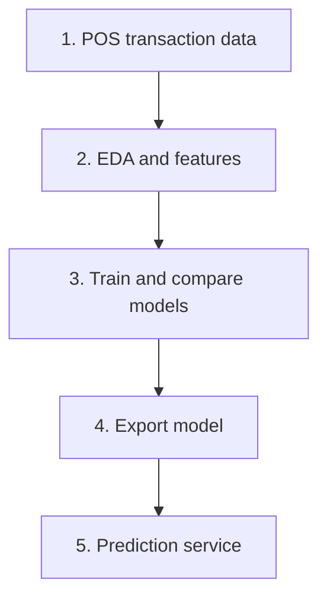

<div align="center">

# Coffee Vending Sales ML

**Machine learning prediction system**

Multiclass drink prediction from real POS transaction logs — from EDA and model comparison to a deployable prediction service.

[](https://www.python.org/)
[](https://scikit-learn.org/)
[](https://mounir-gmamsi.netlify.app/)

</div>

---

## Overview

This project is the midterm for the DataTalks.Club Machine Learning Zoomcamp. It predicts `coffee_name` from vending-machine transaction context to support inventory planning and operational decisions. The work covers exploration, model training and comparison, and a container-ready prediction path.

---

## What the product delivers

| Capability | Description |
|------------|-------------|
| Exploratory analysis | Understand sales patterns by time, payment type and drink mix |
| Feature engineering | Build usable features from POS logs |
| Model training | Train and compare tabular classifiers |
| Evaluation | Accuracy and macro-F1 for imbalanced classes |
| Serving | Prediction API / app path for inference |
| Packaging | Docker-oriented delivery |

---

## Technology stack

### Languages and notebooks


### Data and ML


### Serving and packaging


| Layer | Technologies |
|-------|----------------|
| Analysis | Jupyter, Pandas, NumPy, Matplotlib, Seaborn |
| Modelling | scikit-learn, XGBoost, joblib |
| Serving | Flask, Gradio, prediction scripts |
| Packaging | Docker, requirements.txt |

---

## Solution flow

| Step | Stage | Technologies |
|:----:|-------|--------------|
| 1 | Explore POS data | Jupyter, Pandas |
| 2 | Engineer features | Python, Pandas |
| 3 | Train and compare models | scikit-learn, XGBoost |
| 4 | Export best model | joblib |
| 5 | Serve predictions | Flask / Gradio, Docker |



---

## Repository structure

| File / folder | Purpose |
|---------------|---------|
| `notebook.ipynb` | EDA, training and evaluation |
| `train.py` | Training script |
| `predict.py` / `app.py` | Inference / service entrypoints |
| `models/` | Saved model artefacts |
| `Dockerfile` | Container packaging |
| `requirements.txt` | Python dependencies |

---

## Run locally

```bash
python -m venv .venv
.venv\Scripts\activate
pip install -r requirements.txt
jupyter notebook notebook.ipynb
```

For serving, use the prediction scripts or Docker build as described in the repository files.

---

## Author

**Mounir Gmamsi**  
[Portfolio](https://mounir-gmamsi.netlify.app/) · [GitHub](https://github.com/Mr-Gms-33) · [LinkedIn](https://www.linkedin.com/in/mounir-gmamsi-1595951b3)
